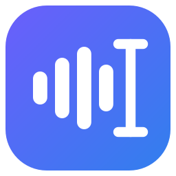
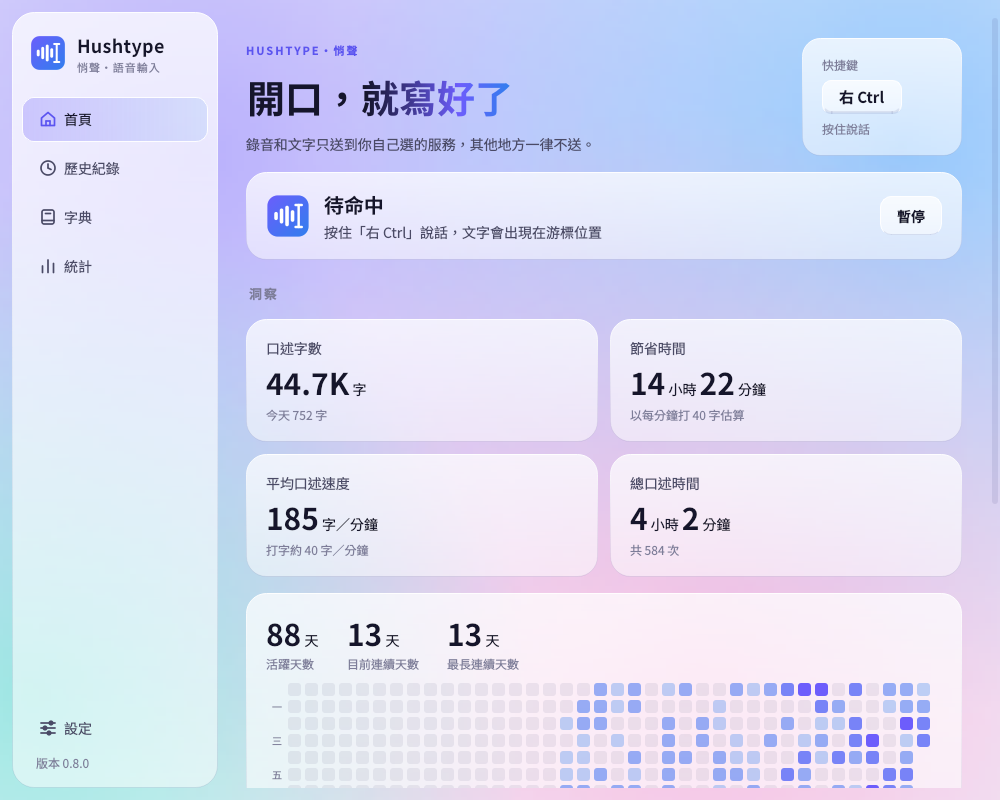
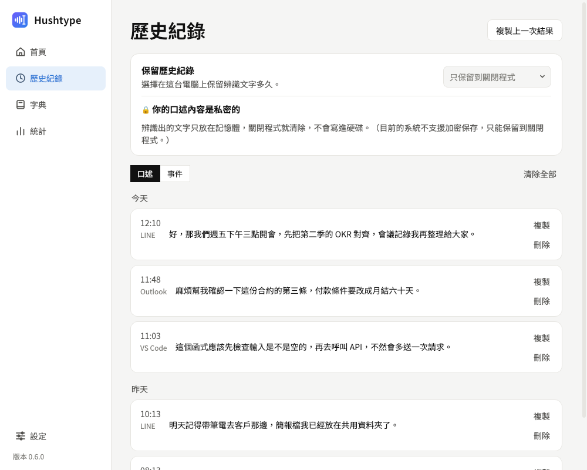
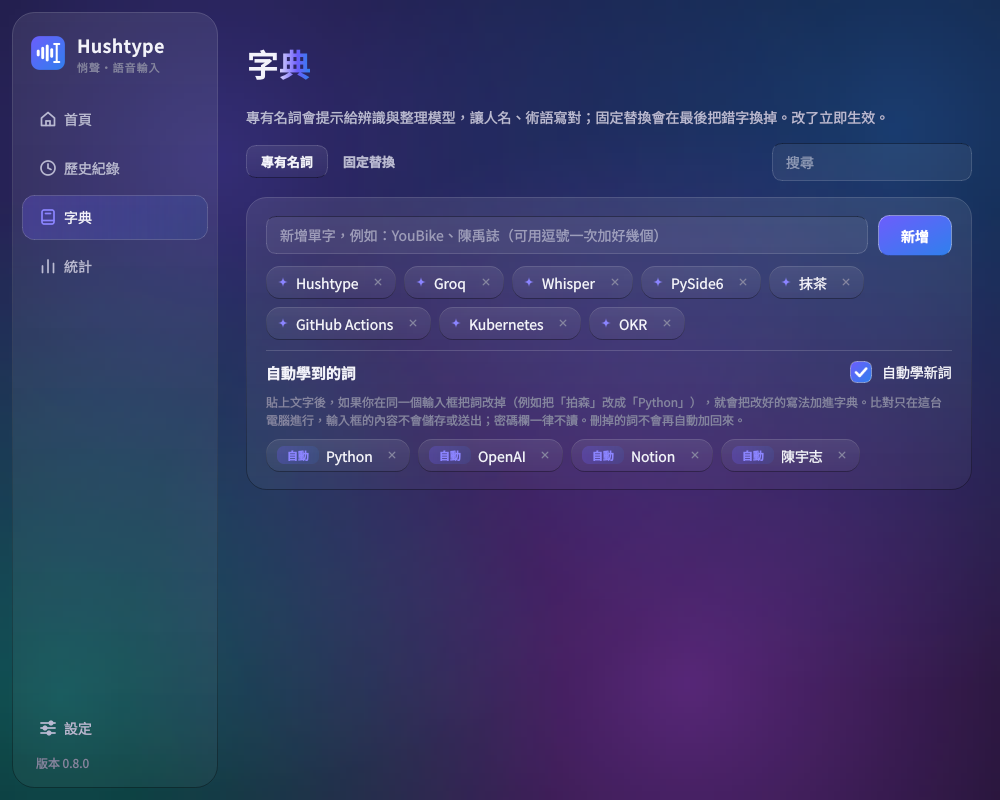
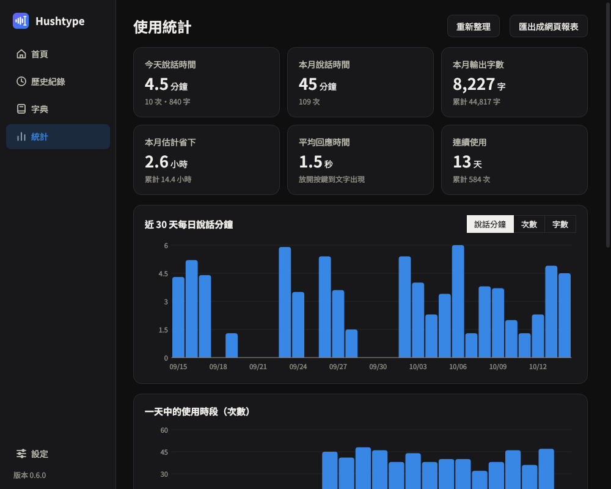
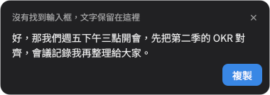

<p align="center"></p>

# Hushtype 悄聲

**重視隱私的 Windows 語音輸入工具。** 在任何程式裡按住快捷鍵說話，放開後自動辨識、去掉贅字、加上標點，貼到游標所在的位置。錄音和文字只送到**你自己選、自己申請金鑰**的服務，也可以完全在自己電腦上執行。

*A privacy-first voice dictation app for Windows: hold a hotkey, speak, release, and cleaned-up text is pasted where your cursor is. Audio only goes to the speech/LLM service you choose with your own API key (Groq, OpenAI, Gemini, or a local OpenAI-compatible server). UI is in Traditional Chinese.*

[](https://github.com/jason7773/hushtype/actions/workflows/build.yml)
[](https://github.com/jason7773/hushtype/releases/latest)
[](LICENSE)

<p align="center">
  
  
  <br>
  
  
</p>

## 為什麼做這個

市面上的 AI 語音輸入工具很好用，但錄音上傳到哪裡、存多久、會不會拿去訓練，使用者完全無法控制。Hushtype 只做一件事：把你的聲音送到**你指定的**服務，換回整理好的文字，其他什麼都不送。

## 功能

- **按住說話，放開就貼上**：任何程式都能用；也可以改成「按一下開始、再按一下結束」
- **AI 整理**：去除「嗯、那個、就是」等贅字，處理說錯改口，加全形標點，長內容自動分段與條列
- **中文、英文、中英夾雜都能說**：自動偵測語言，英文照英文寫、不會被翻成中文；中文用繁體與台灣用語
- **字典**：加入人名、術語讓辨識寫對，或設定固定替換（例如 `拍森 → Python`）
- **自動學新詞**：貼上後你在同一個輸入框把「拍森」改成「Python」，下次就會寫對。比對只在本機進行，輸入框內容不儲存也不送出，密碼欄不讀
- **錄音小視窗**：錄音時螢幕下方出現五條跟著聲音跳動的音波，處理時顯示「轉譯中」，貼上後消失
- **找不到輸入框時不會弄丟文字**：螢幕下方會跳出文字與「複製」按鈕；辨識失敗時錄音會保留，可以按「重試」
- **快捷鍵可用鍵盤或滑鼠中鍵／側鍵**，而且會被攔下，不會同時觸發其他程式（例如 F12 不會打開開發者工具）
- **首頁洞察**：口述字數、節省時間、口述速度，以及像 GitHub 一樣的活躍日曆與連續天數
- **歷史紀錄**：可隨時複製或刪除之前的辨識結果。預設只保留到關閉程式；想保留 1 天、1 週、1 個月或永久時，內容會以 Windows DPAPI 加密存在本機
- **使用統計**：每天、每月說了多久、輸出多少字、在哪些程式用得最多（只記錄數字與程式名稱，不含內容）
- **玻璃質感介面**：流動的極光背景、半透明卡片、跟著游標的光暈，淺色／深色模式都有（可在設定關掉動態效果）
- **常駐系統匣**、開機自動啟動
- **程式內更新**：有新版時按「更新並重新啟動」即可，設定都會保留

<p align="center">
  
  &nbsp;
  
  <br><br>
  
</p>

## 安裝

1. 到 [Releases](https://github.com/jason7773/hushtype/releases/latest) 下載 `Hushtype-setup-x.y.z.exe`
2. 執行安裝檔（不需要系統管理員權限）。Windows 可能顯示「Windows 已保護您的電腦」，按「其他資訊 → 仍要執行」
3. 打開 Hushtype，到「設定」選擇服務、貼上 API 金鑰，按「儲存」
4. 到「首頁」看「系統檢查」，全部是 ✓ 就可以開始用了

系統需求：Windows 10 或 11（64 位元）、麥克風、可連網（使用雲端服務時）。

### Android 版

手機上也能用：Hushtype 是一個語音輸入鍵盤，在任何 App 切換過去按麥克風說話即可。到 [Releases](https://github.com/jason7773/hushtype/releases) 下載 `Hushtype-android-x.y.z.apk` 安裝，詳細說明見 [android/README.md](android/README.md)。

## 選擇服務

語音辨識和文字整理可以分別選不同的服務。金鑰存在 Windows 認證管理員，不會寫進設定檔。

| 服務 | 金鑰申請 | 說明 |
|---|---|---|
| **Groq**（預設） | [console.groq.com/keys](https://console.groq.com/keys) | 有免費額度，速度很快。依其條款，API 資料不會用來訓練模型 |
| **OpenAI** | [platform.openai.com/api-keys](https://platform.openai.com/api-keys) | 付費。API 資料預設不用來訓練，會保留一段時間供濫用審查 |
| **Google Gemini** | [aistudio.google.com/apikey](https://aistudio.google.com/apikey) | ⚠ **免費方案的內容可能被 Google 用來改善產品**，機密內容請開付費方案 |
| **其他 OpenAI 相容服務** | — | 例如自己架的 whisper.cpp、llama.cpp server。填本機網址時資料完全不出你的電腦 |

各家的資料政策會變動，請以該服務最新的條款為準。

## 隱私

- 錄音只放在記憶體，不寫入硬碟；辨識失敗時保留最後一段，供「重試」使用，關閉程式即清除
- 辨識出的文字預設只在記憶體，關閉程式即清除；只有在「歷史紀錄」頁自己選了保留期限才會加密寫入 `%APPDATA%\Hushtype\history.db`
- 使用統計只記錄時間、字數與程式名稱，存在 `%APPDATA%\Hushtype\usage.db`
- 除了你選的服務，程式只會連到 GitHub 檢查新版（可在設定關閉）

詳見 [SECURITY.md](SECURITY.md)。

## 常見問題

**按快捷鍵沒反應？** 到「首頁」看「系統檢查」。如果其他程式是以系統管理員身分執行，一般權限的 Hushtype 收不到在那個視窗裡按的快捷鍵，這是 Windows 的限制。

**文字沒有貼上？** 游標要在可以打字的地方。找不到輸入框時，螢幕下方會出現「複製」框；「歷史紀錄」頁與系統匣選單也能複製上一次的結果。

**有些字常常辨識錯？** 到「字典」加入專有名詞，或設定固定替換（例如 `拍森 → Python`）。

**從舊版 dictate 升級？** 直接安裝新版即可，設定、金鑰、統計與開機啟動都會自動搬過來。

**想完全離線？** 在「設定」把服務改成「其他 OpenAI 相容服務」，填本機 whisper.cpp / llama.cpp server 的網址即可。

## 開發

需要 Python 3.12 與 Windows（快捷鍵、貼上、UI Automation 都依賴 Windows）。

```
py -3.12 -m venv .venv
.venv\Scripts\pip install -r requirements.txt pytest
.venv\Scripts\pythonw hushtype.pyw            # 開啟應用程式
.venv\Scripts\python -m hushtype --console    # 在 terminal 執行（除錯用）
.venv\Scripts\python -m pytest
```

本機打包需要 [Inno Setup 6](https://jrsoftware.org/isdl.php) 與 `pip install pyinstaller`，然後執行 `pwsh packaging\build.ps1 -Version 0.0.1`。

### 架構

```
hushtype/
  engine.py       快捷鍵、錄音、處理、貼上；以事件回報狀態（介面與主控台共用）
  pipeline.py     辨識 → 繁體 → LLM 整理 → 替換（與平台無關）
  providers/      服務介面、註冊表與各家實作
  hotkeys.py      鍵盤與滑鼠快捷鍵、錄製按鍵
  focus.py        判斷游標是不是在輸入框（UI Automation）
  audio.py        麥克風錄音，輸出記憶體中的 WAV
  output.py       剪貼簿貼上或模擬打字
  config.py       設定檔讀寫與預設整理規則
  keystore.py     API 金鑰存取（Windows 認證管理員）
  autostart.py    開機自動啟動
  updater.py      檢查、下載、安裝新版
  stats.py        本機使用紀錄（SQLite）與彙總
  history.py      歷史紀錄（記憶體或 DPAPI 加密的 SQLite）
  learning.py     從使用者的修改自動學新詞（本機比對）
  gui/            主視窗、系統匣、錄音小視窗、複製框、首頁／歷史／字典／統計／設定頁
packaging/        PyInstaller + Inno Setup 打包、簽章腳本
```

### 新增其他服務

OpenAI 相容的服務在設定頁選「其他 OpenAI 相容服務」並填網址即可。其他服務在 `hushtype/providers/` 新增模組：

```python
from .base import SpeechToText, register_stt

@register_stt("azure")
class AzureSTT(SpeechToText):
    def __init__(self, region: str, api_key_env: str = "AZURE_SPEECH_KEY", **kw): ...
    def transcribe(self, wav: bytes, *, prompt: str | None = None) -> str: ...
```

再到 `hushtype/providers/__init__.py` 匯入它。文字整理服務同理，用 `TextCleaner` 與 `@register_cleaner`。

### 發佈新版

把 `hushtype/__init__.py` 的 `__version__` 改成新版本號並推到 `main`，GitHub Actions 會測試、打包並建立 `v版本號` 的 Release，已安裝的程式就會提示更新。版本號沒變的 commit 也會打包，安裝檔放在 Actions 的 Artifacts。

### 程式碼簽章（維護者）

`packaging\setup-signing.bat` 會建立自簽的程式碼簽章憑證、讓本機信任它，並引導把憑證存到 GitHub Secrets（`CERT_PFX_BASE64`、`CERT_PASSWORD`），之後的安裝檔會自動簽章。自簽憑證只有在匯入過的電腦上被信任；要讓所有人都不出現警告，需要向憑證機構購買憑證或使用 Azure Trusted Signing。

## 授權

[MIT](LICENSE)。安裝檔內附的第三方元件見 [THIRD_PARTY_NOTICES.md](THIRD_PARTY_NOTICES.md)。

作者：[@jason7773](https://github.com/jason7773)（抹茶），與 Claude 協作開發。
